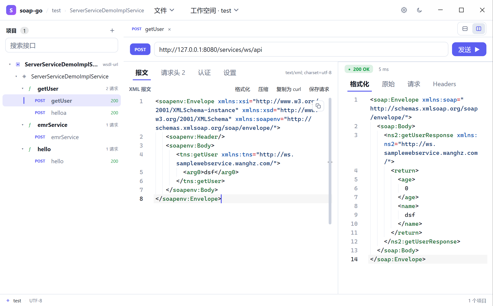

# soap-go

SOAP / WSDL 接口调试桌面工具，用 **Go + MyGo 原生 UI**（纯 Go 绘制，无 WebView）



## 功能

- **项目树**：项目 → 目录/请求（普通 HTTP），以及导入的 项目 → 服务 → 操作 → 请求样例（SOAP），展开折叠、搜索过滤、显示上次响应状态码
- **请求编辑**：普通 HTTP 请求可选方法（GET/POST/PUT/PATCH/DELETE/HEAD/OPTIONS）、URL 与「查询」页签双向同步；Body 类型可选 No Body / JSON / XML / GraphQL / Other / Url Encoded / Multi-Part / Binary File，按类型提供文本编辑器（JSON/XML 高亮）、表单字段或文件选择；SOAP 请求固定 POST，含 SOAPAction、Content-Type、XML 格式化；超时、请求头（项目默认 + 样例覆盖 + 敏感头遮蔽）
- **发送请求**：真实 HTTP / SOAP 请求，支持代理（系统 / 直连 / 自定义 HTTP·SOCKS5）、超时、响应截断；GET/HEAD 不发送请求体
- **响应查看**：格式化 / 原始 / 请求 / Headers 四个视图，状态码、耗时、大小；悬停显示复制图标，发送成功后自动保存最近响应
- **导入**：SoapUI 项目（.xml）、WSDL 文件、WSDL URL（可选代理）；SOAP 请求只能通过这些导入产生
- **导出**：工作空间 JSON（可选保留代理）；SoapUI 项目可导出为 SoapUI XML（普通 HTTP 项目不支持导出）
- **认证**：Basic（用户名/密码）与 Bearer（令牌 + 可改 Prefix），可启用/禁用，密码与令牌默认遮蔽
- **管理**：工作空间切换/新建/重命名/删除/导入/导出；项目、目录、请求的增删改，以及导入项目下的服务/操作，均在树节点右键菜单
- **其它**：上下/左右分屏、深色/浅色主题、主题色（8 种可选）、界面与编辑器字体设置（字体和字号分别可调）、主题与分栏布局持久化、请求可取消


## 数据兼容

数据格式与 soap-web **完全一致**（`settings.json`、`projects.json`）。

把 soap-web 的 `bin/data` 下的 `settings.json` 与 `projects.json` 复制到 soap-go 的数据目录，即可看到原有项目。主题、分栏布局和字体设置保存在数据目录的 `ui-state.json`。

数据目录默认为可执行文件旁 `data/`，也可用 `-data <目录>` 指定。macOS 上从 `.app` 启动时会改用 `~/Library/Application Support/soap-web/data/`（避免往被签名的包内写文件而破坏签名）。

## 运行

### 预编译版

- Windows：运行 `soap-go.exe`
- macOS：把 `soap-go.app` 拖进「应用程序」后打开

首次运行会自动创建数据目录与默认工作空间。

### 从源码构建

各平台统一用 MyGo 自带的打包命令（`go tool mygo build`，由 `go.mod` 的 `tool` 指令固定版本），产出规范的应用包：

```powershell
go tool mygo build                       # 构建本机平台到 build/<os>-<arch>/
go tool mygo build -platform darwin/arm64,windows/amd64,linux/amd64
```

- macOS：`build/darwin-<arch>/soap-go.app`（真正带 `Info.plist`、图标与签名的应用包，双击不会额外弹出命令窗口；数据写到 `~/Library/Application Support/soap-web/`）
- Windows：`build/windows-amd64/soap-go.exe`（已内嵌 `windowsgui`，不会额外弹出控制台窗口）
- Linux：`build/linux-amd64/soap-go`

本地调试也可以直接 `go run .`；日志写入数据目录旁的 `logs/soap.log`。

需要 **Go 1.27.3+**（MyGo 的版本要求）。

### 测试

```powershell
go vet ./...
go test ./...
```

## 快捷键

| 快捷键 | 作用 |
|---|---|
| `Ctrl+Enter` | 发送请求 |
| `Ctrl+S` | 保存请求样例 |
| `Ctrl+Shift+F` | 格式化 XML |
| `Ctrl+K` | 聚焦项目树搜索 |

## 目录结构

```
main.go        入口：数据目录、日志、窗口、退出时保存布局
app.go         应用状态与操作（加载/保存/发送/导入/CRUD/工作空间/持久化）
view.go        原生 UI：工作台、请求 Tab、分区、弹窗、右键菜单
theme.go       深色 / 浅色主题
internal/      从 soap-web 移植的业务包
  model        数据模型
  store        项目持久化与 CRUD
  workspace    多工作空间注册表
  wsdl         WSDL 解析
  wsdlfetch    远程 WSDL 抓取
  soapuiproj   SoapUI 项目导入 / 导出
  transport    HTTP/SOAP 发送（支持 context 取消、代理、字符集）
  charset      字符集解码
  fileutil     原子写文件
  applog       日志
  appsetup     数据目录与注册表初始化
```

## 发布

推送 `v*.*.*` 形式的 tag 会触发 `.github/workflows/release.yml`：

- 先跑 `go vet` / `go test`，通过后构建
- Windows / Linux 用 `go build` 直接产出可执行文件与归档
- macOS 用 `go tool mygo build` 打包成 `.app` 并产出 `.dmg` 磁盘映像（CI 上无签名身份，用临时签名）；用户打开 dmg 把 app 拖进「应用程序」，首次打开若被 Gatekeeper 拦截，执行一次 `xattr -dr com.apple.quarantine "/Applications/soap-go.app"`
- 自动创建 GitHub Release，附 `SHA256SUMS.txt`
## 说明

- 界面由 MyGo 的原生 UI 工具包绘制，不依赖 WebView
- 项目树节点的操作（新建项目/目录/请求、导入项目的服务/操作/请求，以及重命名、复制、删除）都在**右键菜单**里。
- 新建项目是普通 HTTP 项目：可在项目或目录下直接创建请求；SOAP 请求只能由 SoapUI / WSDL 导入产生；普通 HTTP 项目不支持导出 SoapUI XML。
- 已知差异：原 web 版的树键盘导航未实现；提示采用底部状态栏而非浮层 Toast。
